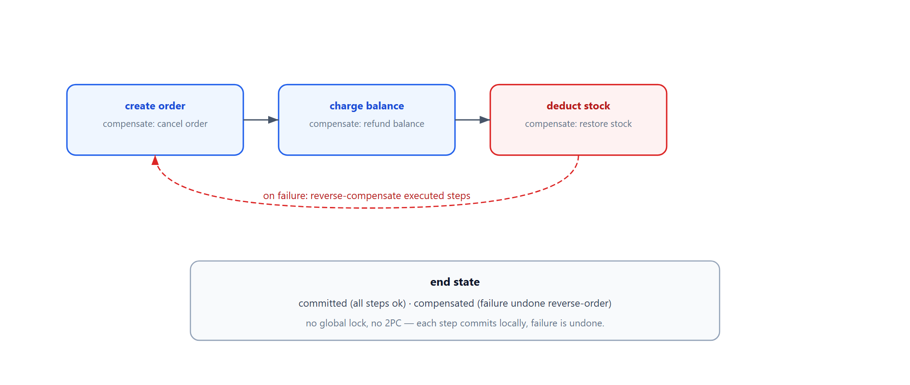
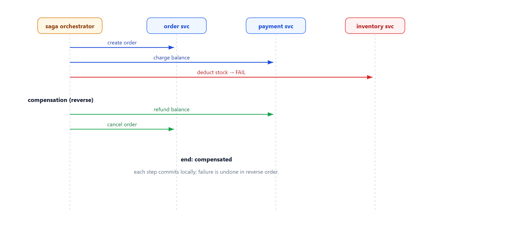

# Learn Saga Orchestration — Long Transactions with Compensation

> **Learning / study repo. Self-contained demo, NOT production code.**
> A long business process is split into local steps. Each step has a forward action and a
> compensating action. If a step fails, the steps already completed are compensated in
> reverse order — no distributed lock, no 2PC.

## The idea

```
  create order → charge balance → deduct stock
       │              │                │
       │              │                └─ fail → compensate: restore stock
       │              └─ compensate: refund balance
       └─ compensate: cancel order
```

- Each step commits its own local transaction.
- No global lock holds across the whole process.
- Failure triggers a reverse-compensation chain to undo prior steps.
- Ends in either **committed** or **compensated** (never half-done).



## Why this matters

- **No distributed transaction needed** — each service owns its own commit.
- **Availability over strict isolation** — partial progress is OK as long as it can be undone.
- **Natural for cross-service workflows** — orders, payments, inventory, shipping.

## Run

```bash
python run_all.py
```

Pure Python standard library.

## Demo cases

1. **All succeed** — order created, balance charged, stock deducted; status `committed`.
2. **Stock fails** — reverse compensation refunds balance and cancels the order.
3. **Balance fails early** — only the order creation is compensated (cancelled).

## Flow



## Sibling repos

- `learn_distributed_txn` — pre-freeze + state machine for stronger consistency.
- `learn_circuit_breaker` — fail fast when downstream is down.
- `learn_actor_model` — message-driven actors for step coordination.
